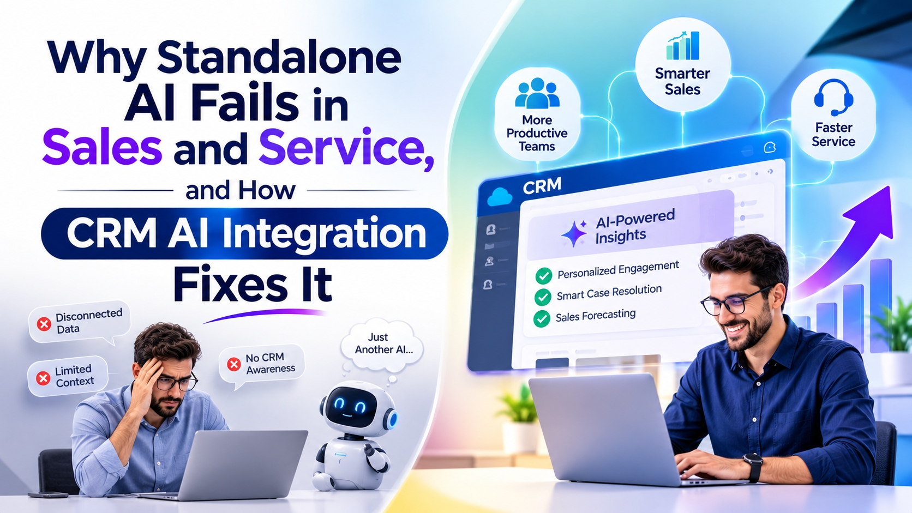

# Why Standalone AI Fails in Sales and Service, and How CRM AI Integration Fixes It

A chatbot or writing assistant that sits outside the CRM can look useful in a trial. In daily sales and service work it keeps missing, because it does not know who the customer is, what was promised last week, or what the account is worth. The gap is context, and integration is how teams close it.

Predictions and suggestions are only as good as the records behind them, which is why a thoughtful approach to [predictive CRM analytics integration](https://zignuts.com/ai-services/ai-integration/crm-ai-integration-services?utm_source=seo_web2.0&utm_medium=backlink&utm_campaign=seo_referral&utm_id=11) keeps the AI connected to live CRM data instead of working beside it.

## Standalone vs Integrated

| Area | Standalone AI | CRM-integrated AI |
|---|---|---|
| Customer context | Pasted in by hand | Read from live CRM records |
| Permissions | Separate or unclear | Follows CRM roles and sharing rules |
| Actions | Suggests only | Updates records and triggers workflows with approval |
| Data freshness | Depends on the user | Current at the time of the request |
| Measurement | Hard to tie to outcomes | Linked to pipeline and case metrics |

## Where Standalone AI Fails

**In sales**
- Generic outreach that ignores role, history, and stage
- Weak prioritization without pipeline data
- Manual copying that leaves the CRM out of date
- Forecasts built on partial data

**In service**
- Answers without account context
- Customers repeating problems because history is hidden
- Suggestions that cannot be performed or logged
- Escalations that lose detail

## Implementation Steps

1. **Pick one workflow** with a clear baseline, such as lead follow-up or case summaries.
2. **Clean the key fields** by fixing duplicates and missing values.
3. **Connect with least access** to only the objects and fields needed.
4. **Start in suggest mode** so users can accept, edit, or reject.
5. **Measure against the baseline** for time saved, response speed, and conversion or resolution.
6. **Expand carefully** with automation for low-risk, reversible tasks.

## Guardrails Checklist

- [ ] AI access follows CRM roles and field-level security
- [ ] Consequential actions need human approval
- [ ] Every AI-written change is logged to the record
- [ ] A rollback option exists for automated steps
- [ ] Quality is tested on a fixed set of real examples

## Get Started

Ready to bring AI into your CRM? Visit [zignuts.com](https://zignuts.com/) to speak with the team.

## Publish with GitHub Pages

1. Add `intelligent-crm-agent-orchestration.jpg` to the repository root.
2. Go to **Settings > Pages**, choose the `main` branch and the `/ (root)` folder, then save.
3. The site will be available at `https://harshp-zigs.github.io/multi-crm-ai-agent-connector/`.

## Topics

`crm-ai-integration` `sales-ai` `customer-service-ai` `ai-agents` `predictive-analytics` `crm-data` `enterprise-ai`
